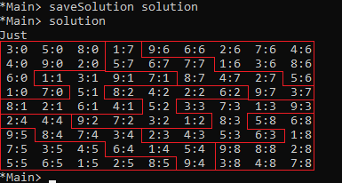
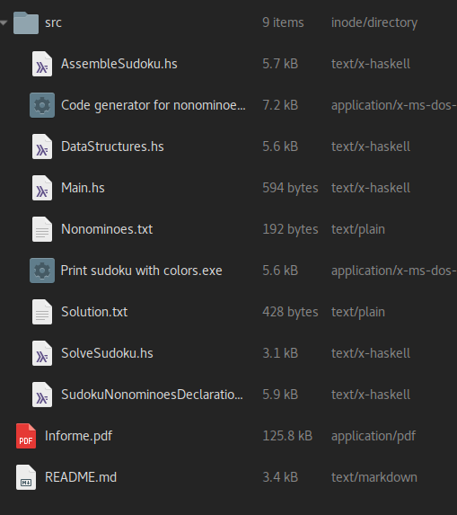

# Sudoku Nonominós

**Jorge Rodríguez de la Vega, C-412**
**Mayo, 2019**

### Ejecutar el proyecto

La implementación fue realizada utilizando **GHC** y **GHCi**, pero fue probado además en **Hugs** y se garantiza que funciona en este. Para ejecutar el proyecto usando **GHCi**, primeramente abra una terminal en la carpeta raíz del código (`src`) y siga el orden de ejeución de las líneas:

```bash
$ ghci
GHCi, version 8.6.4: http://www.haskell.org/ghc/  :? for help
Prelude>:set prompt "ghci> "
ghci> :load Main.hs
[1 of 5] Compiling DataStructures   ( DataStructures.hs, interpreted )
[2 of 5] Compiling AssembleSudoku   ( AssembleSudoku.hs, interpreted )
[3 of 5] Compiling SolveSudoku      ( SolveSudoku.hs, interpreted )
[4 of 5] Compiling SudokuNonominoesDeclaration ( SudokuNonominoesDeclaration.hs, interpreted )
[5 of 5] Compiling Main             ( Main.hs, interpreted )
Ok, five modules loaded.
*Main> saveSolution solution
*Main>
```

`Main.hs` es el _entry point_ del proyecto, desde aquí se llaman a las funciones que se encargan de ensamblar el _sudoku_ a partir de los _nonominós_ y de resolver el mismo una vez quede armado.

En `Main.hs` se definen 2 funciones:

- `solution :: Maybe Sudoku` se encarga de resolver el _sudoku_ y mostrarlo (en caso de que este no pueda ser resuelto se mostrará un mensaje de error)
- `saveSolution :: Show a => a -> IO ()` se debe llamar de la forma especificada más arriba (pasando `solution` como parámetro) y además de resolver el _sudoku_, se encarga de escribir la respuesta en el fichero `Solution.txt`.

### Casos de prueba

En la carpeta `src` se encuentran 2 ficheros pensados específicamente para facilitar la corrida de diferentes casos de prueba:

- `Nonominoes.txt` aquí se insertan los nonominós como se muestra en el fragmento del ejemplo más abajo. Los números del `1` al `9` representan valores iniciales para esas casillas, los `0` representan casillas en blanco y los `.` son las posiciones que no forman parte del nonominó pero son necesarias para representarlo. **Es importante dejar una línea en blanco al final de la declaración pues de lo contrario el programa no tendrá en cuenta el último nonominó declarado**:

```txt
00010
.000
..0

.2030
00090

```

- `Code generator for nonominoes.exe` es un ejecutable que lee de `Nonominoes.txt`, interpreta los nonominós y esribe en `SudokuNonominoesDeclaration.hs` código _Haskell_ que genera dichos nonominós.

Este fichero puede ser editado por el usuario y este puede introducir los nonominós por sí mismo, pero se brindan estas herramientas para facilitar el uso del proyecto.

### Visualizar los resultados

Si bien al tipo de datos `Sudoku` le fue implementado un `Show` que muestra el _sudoku_ en un formato legible, este puede no resultar ideal, pues lo que muestra es una matriz donde los elementos son de la forma `n:ID` donde `n` representa el número que quedó en esa posición del _sudoku_, e `ID` representa el _nonominó_ al cual pertenece la casilla de esa posición.

Como alternativa, se ofrece el ejecutable `Print sudoku with colors.exe` que permite visualizar el _sudoku_ y los nonominós de manera mucho más legible, pues en lugar de aparecer con el formato anterior, aparecen solamente los números del _sudoku_, cada uno de un color según el nonominó que le corresponde.

Los resultados en Haskell lucen de la siguiente forma al visualizarlos, las regiones delimitadas por las líneas rojas son los nonominós:



### Estructura del proyecto

El proyecto debería tener la siguiente estructura de ficheros:



y una carpeta oculta `.media` de donde se están leyendo estas fotos... ;)

<!-- <div style="text-align:center"></div> -->
